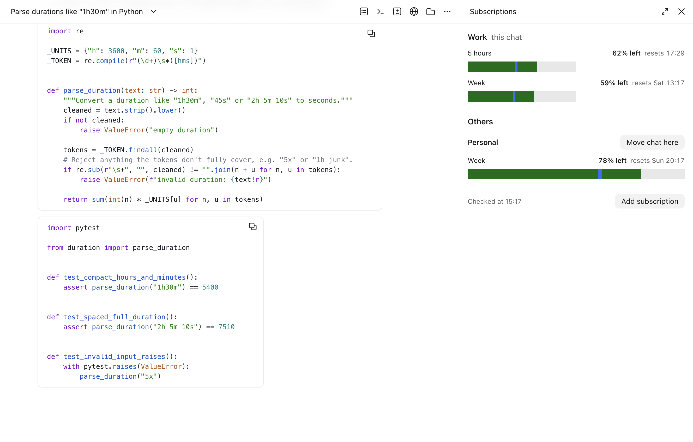

# claude-accounts

Run every Claude Code session in Claude Desktop on its own Claude subscription, in one window.



Claude Desktop gives every Code session the token of the account you are signed in to. If you
have several subscriptions (work, personal, a team seat, a friend's spare Ultra), you either sign
out and in all day or run two apps. claude-accounts runs a patched copy of Claude Desktop that,
per Code session, swaps in another subscription's long-lived token, and adds a **Subscriptions**
pane next to the chat:

- what is left of each subscription's 5-hour and weekly limit, each bar drawn to the plan's size,
  with a blue mark where an even spend would be now (green ahead of that pace, amber a little
  behind, red far behind);
- **Move chat here** — the chat restarts on that subscription as soon as it is idle (the app's
  own quiet restart, no "interrupted" notice);
- **Add subscription** — macOS dialogs, a sign-in page in the browser you pick, done. No terminal.

New chats pick a subscription by themselves: the one with the most weekly limit that would
otherwise go unused before its reset, weighted by plan size. Sub-sessions stay on their parent's.
Folder rules can pin a project to a subscription. Set `"autoPlace": false` (or run `acct auto off`)
to turn the automatic placement off: a new chat then stays on the desktop login until moved by hand,
and a subscription that fails its check falls back to the desktop login.

## Install

Needs macOS, Claude Desktop in `/Applications`, and Node.js (`brew install node`).

```bash
git clone https://github.com/nkvch/claude-accounts.git ~/claude-accounts
~/claude-accounts/install.sh
```

Then quit Claude and open **Claude Launcher** from `~/Applications` (put it in the Dock and use it
instead of Claude). The launcher rebuilds the patched copy (`~/Applications/Claude Accounts.app`)
whenever Claude updates; if a Claude update ever breaks the patch, it opens the official app and
tells you.

Set the plan of the account Claude Desktop is signed in to in `~/.claude-accounts/accounts.json`
(`plan`, and `proX` = times Pro usage per week: Pro 1, Max 5x 5, Ultra 10, Max 20x 20, Team Premium 6.25).

## Config: `~/.claude-accounts/`

| File | What |
| --- | --- |
| `accounts.json` | subscriptions (see `accounts.example.json`): `label`, `tokenKey`, `plan`, `proX`, optional `note`, `auto: false` to never pick it for new chats, `env`; top-level `autoPlace` (default `true`; `false` = no automatic placement of new chats, no fallback to another subscription), `rules` pin folders to an account; optional `envFile` to keep tokens in another dotenv file |
| `tokens.env` | the long-lived tokens (`CC_TOKEN_<NAME>=…`, from `claude setup-token`), mode 600 |
| `state/` | `hook.log` (which session got which account), `launch.log`, `limits.json`, `overrides.json` |
| `inject.js` | optional: your own script run in every page of the app |
| `demo.json` | optional: made-up subscriptions for screenshots (copy `demo.example.json`); remove it to see your own |

`CLAUDE_ACCOUNTS_HOME` moves the folder.

## In a session

- `/acct` shows the chat's subscription; `/acct <name>` moves it (same as the pane's button).
- `acct auto` shows whether new chats are placed automatically (`on`/`off`); `acct auto on|off` sets `autoPlace` in `accounts.json`, the next new chat follows it.
- `/limits` reopens the pane.

## How it works

`app/patch.js` edits a copy of Claude Desktop's `app.asar` in four places, each matched exactly
once or the build fails and touches nothing: it loads `app/hook.js` at startup, lets the hook
choose the token when a Code session's process is spawned (and keeps the desktop's own token out
of it), exposes the app's quiet session restart, and turns the copy's self-updater off. The copy is
re-signed ad hoc. `app/logic.js` holds the choosing logic and is reloaded on every call. Usage
numbers come from the rate-limit headers of a 1-token request per subscription, every 10 minutes.

Not covered: claude.ai chats, the app's own usage ring (it shows the desktop login), SSH and cloud
sessions.

## Uninstall

```bash
rm -rf ~/Applications/"Claude Accounts.app" ~/Applications/"Claude Launcher.app"
claude plugin uninstall subscriptions@claude-accounts
```

`~/.claude-accounts` holds your tokens: delete it too if you do not want to keep them.
